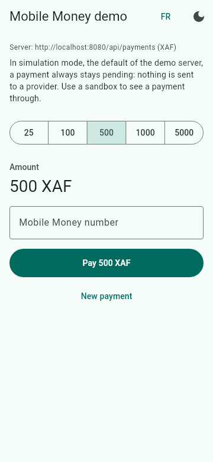

# sdk-mobile-money

Collect and disburse Mobile Money payments in Cameroon through a single
interface, whatever the provider behind it: MTN MoMo, Campay, NotchPay or Tara.

[](https://github.com/Backaad/sdk-mobile-money/actions/workflows/ci.yml)
[](https://codecov.io/gh/Backaad/sdk-mobile-money)
[](https://central.sonatype.com/artifact/io.github.backaad/sdk-mobile-money-core)
[](https://pub.dev/packages/sdk_mobile_money)
[](LICENSE)

*[Lire en français](README.fr.md)*

> **Released** on Maven Central and pub.dev: the badges above show the latest
> versions.

<p align="center">
  
  <br>
  <sub>The Flutter demo app, rendered by the Flutter test engine against a fake
  server that confirms the payment, as a sandbox would. Not a screen recording.</sub>
</p>

## Why this SDK

- **One interface** for MTN MoMo, Campay, NotchPay and Tara: change provider by configuration, not by code.
- **Keys stay on your server**: the Flutter package only talks to your server, never to a provider.
- **Webhooks are verified**, then the status is read again from the provider before a payment is confirmed.
- **Nothing is charged twice**: every payment has an idempotency key, and a request whose answer was lost is never sent again.

## Providers

| Provider | Collection | Payout | Status read | Webhooks | Sandbox | Verified against |
|---|---|---|---|---|---|---|
| [Campay](docs/providers/campay.md) | yes | yes | yes | JWT HS256, then status read | yes | Campay's own SDKs; details to be confirmed |
| [MTN MoMo](docs/providers/mtn-momo.md) | yes | yes | yes | unsigned, status read | yes, public | to be confirmed |
| [NotchPay](docs/providers/notchpay.md) | yes | yes | yes | HMAC-SHA256, then status read | test keys | to be confirmed |
| [Tara](docs/providers/tara.md) (experimental) | yes | no | no | single-use callback URL | to be confirmed | to be confirmed |
| Orange Money direct | planned | planned | | | | requires a partnership |

No provider has been run against its sandbox by the project yet: it has no
keys of its own. Until then, every provider is tested against a mock server
built from its documentation. Failover to another provider happens only if you
configure it, and only when nothing reached the first provider. Until Orange
Money direct exists, Orange Money customers go through an aggregator: NotchPay
has an Orange channel; Campay and Tara are to be confirmed.

## Quick start

### Your server, with Spring Boot

1. Add the starter (Spring Boot 4, Java 17 or later):

   ```xml
   <dependency>
       <groupId>io.github.backaad</groupId>
       <artifactId>sdk-mobile-money-spring-boot-starter</artifactId>
       <version>0.1.1</version>
   </dependency>
   ```

2. Configure a provider. Keys come from the environment, never from a
   committed file:

   ```yaml
   mobile-money:
     callback-base-url: https://shop.example/mobile-money/webhooks
     campay:
       environment: sandbox
       username: ${CAMPAY_USERNAME}
       password: ${CAMPAY_PASSWORD}
       webhook-key: ${CAMPAY_WEBHOOK_KEY}
   ```

   No account yet? `mobile-money.simulation.enabled: true` talks to nobody and
   never confirms a payment. An incomplete or dangerous configuration prevents
   startup, with a message that names the property to fix.

3. Start a payment:

   ```java
   @RestController
   class PaymentController {

       private final MobileMoney mobileMoney;
       private final Orders orders;

       PaymentController(MobileMoney mobileMoney, Orders orders) {
           this.mobileMoney = mobileMoney;
           this.orders = orders;
       }

       @PostMapping("/api/payments")
       Map<String, Object> pay(@RequestHeader("Idempotency-Key") String key, @RequestBody PayBody body) {
           Order order = orders.get(body.orderId()); // the amount comes from the order, never from the app
           Transaction transaction = mobileMoney.collect(PaymentRequest.builder()
                   .idempotencyKey(key)
                   .amount(order.amount())
                   .phoneNumber(body.phoneNumber())
                   .merchantReference(order.reference())
                   .description("Order " + order.reference())
                   .build());
           return Map.of("reference", transaction.merchantReference(), "status", transaction.status().name());
       }
   }
   ```

4. Learn the outcome. The starter receives the webhooks on
   `/mobile-money/webhooks/<provider>`, verifies them, reads the status again,
   and publishes an event:

   ```java
   @EventListener
   void onOutcome(PaymentOutcomeEvent event) {
       if (event instanceof PaymentConfirmedEvent) {
           // mark the order event.merchantReference() as paid, once
       }
   }
   ```

More in [docs/spring-boot.md](docs/spring-boot.md). Without Spring, use the
core library directly: start from `MobileMoney.builder()` (see its Javadoc).

### Your app, with Flutter

```yaml
dependencies:
  sdk_mobile_money: ^0.1.1
```

```dart
final client = MobileMoneyClient(
  paymentsUrl: Uri.parse('https://shop.example/api/payments'),
);

MobileMoneyCheckout(
  client: client,
  amount: 1500,
  extra: {'orderId': '42'},
  onCompleted: (payment) {
    // PaymentStatus.successful or PaymentStatus.failed
  },
)
```

The form validates the number with the same rules as the server, shows the
detected operator, asks the customer to confirm on the phone, and follows the
payment. The package README describes the
[server contract](flutter/sdk_mobile_money/README.md#the-server-contract) and
the client without the form.

### Try the demos

```sh
(cd examples/spring-boot-demo && docker compose up --build)   # server and Redis, simulation
(cd examples/flutter-demo && flutter run)                     # app, on an emulator
```

See [the demo server](examples/spring-boot-demo) and
[the demo app](examples/flutter-demo).

## Security

- Provider keys live on the server only, in environment variables or a secret
  store. The Flutter package never holds one.
- A webhook is trusted only after its signature (compared in constant time) or
  its single-use URL is checked, and after the status is read again from the
  provider that sent it, when the provider allows it.
- A transient error while reading a status leaves the payment pending; it
  never marks it as failed. The simulation never confirms a payment.
- Logs never contain a key, a token, a signature, or a body that holds one.

Each of the eleven rules behind these points has its tests: see
[docs/security.md](docs/security.md). To report a vulnerability, follow
[SECURITY.md](SECURITY.md), never a public issue.

## Roadmap

- **0.1.x**: first releases, on Maven Central and pub.dev.
- Confirm everything marked "to be confirmed" against the sandboxes and the
  official documentation: provider details, and the default phone prefix table
  against the numbering plan of ART, the Cameroon regulator.
- `XOF` and other countries; the architecture is ready for them.
- Orange Money direct, once a partnership allows it.
- Not planned for now, maybe later: card payments, subscriptions, automatic
  refunds, a web dashboard, SDKs for other languages (Node, PHP, Python).

## Contributing

Contributions are welcome, new providers especially: read
[CONTRIBUTING.md](CONTRIBUTING.md) and the
[code of conduct](CODE_OF_CONDUCT.md).

| Path | Content |
|---|---|
| `java/sdk-mobile-money-core` | Java 17+ server library, no Spring |
| `java/sdk-mobile-money-spring-boot-starter` | Spring Boot integration |
| `flutter/sdk_mobile_money` | Flutter package; talks only to the merchant's server |
| `examples/spring-boot-demo` | Demo server, simulation by default |
| `examples/flutter-demo` | Demo app that pays through the demo server |
| `testdata/` | Reference phone numbers shared by the Java and Dart tests |
| `docs/` | [Architecture](docs/architecture.md), [security](docs/security.md), [providers](docs/providers), [releasing](docs/releasing.md) |

```sh
(cd java && ./mvnw verify)                                                         # Java
(cd flutter/sdk_mobile_money && flutter pub get && flutter analyze && flutter test) # Flutter package
(cd examples/flutter-demo && flutter pub get && flutter analyze && flutter test)    # demo app
```

## License

[MIT](LICENSE)
