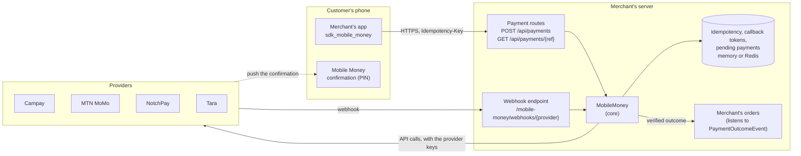
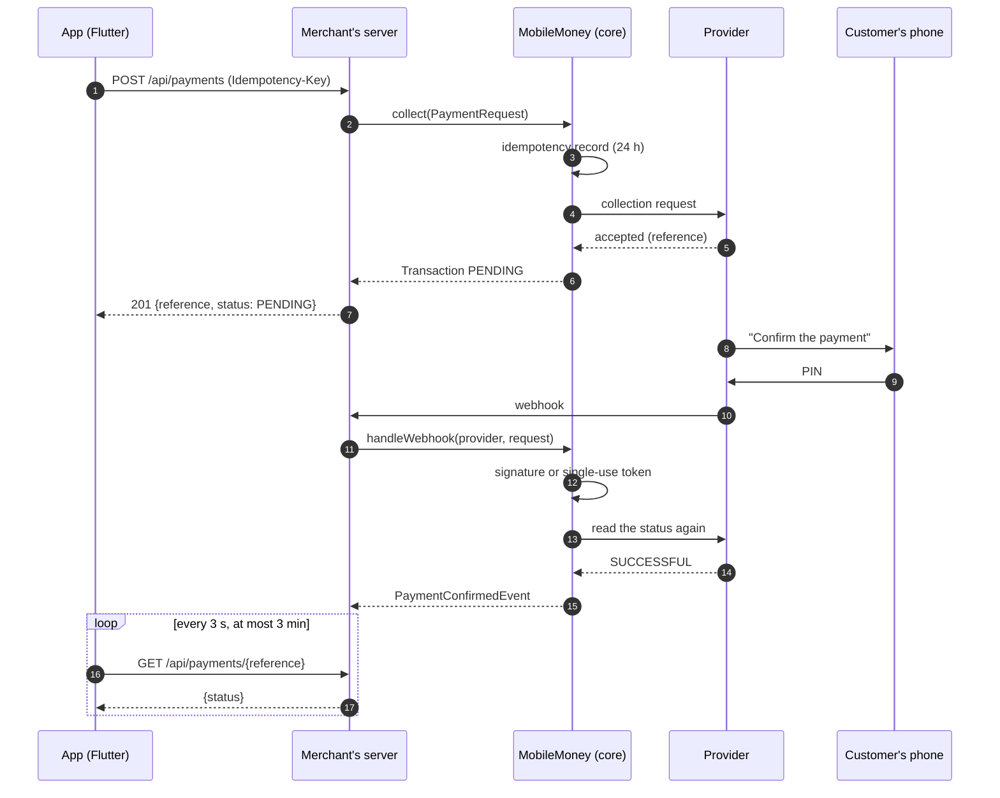

# Architecture

The SDK has three parts. A **Java core**, a server library without Spring, talks
to the providers. A **Spring Boot starter** configures the core, receives the
webhooks and publishes Spring events. A **Flutter package** lets an app pay
through the merchant's server. The app never talks to a provider: provider keys
stay on the server.

## A payment, step by step

The app's polling and the webhook are independent. The order is settled on the
server, from the verified webhook or from a status read. What the app shows is
only for the customer.

## Java core (`sdk-mobile-money-core`)

Runtime dependencies: the JDK HTTP client, Jackson 3 and SLF4J, nothing else
(the Maven enforcer checks it).

| Package | Role |
|---|---|
| `io.github.backaad.mobilemoney` | `MobileMoney`, the entry point; the common model (`PaymentRequest`, `PayoutRequest`, `Transaction`, `TransactionStatus`, `WebhookEvent`, `ProviderCapabilities`); typed errors |
| `…provider` | `PaymentProvider`, the interface each provider implements; `ProviderFactory`, which builds providers from the variables of `.env.example` |
| `…provider.campay`, `.mtnmomo`, `.notchpay`, `.tara`, `.simulation` | one adapter per provider; each only talks to its API |
| `…phone` | `PhoneNumber` (normalization), `PrefixTable` (operator detection), `ProviderPhoneFormat` (each provider's number format) |
| `…idempotency` | `IdempotencyStore` and its in-memory implementation |
| `…callback` | single-use callback tokens (Tara) |
| `…internal` | HTTP calls, token cache, constant-time comparison, JWT HS256, JSON; not part of the API |

`MobileMoney` owns what must not depend on a provider:

- **Idempotency.** Every collection and payout is recorded under its key for
  24 hours. The same request returns the first result; the same key with
  another request is refused.
- **Unknown outcomes.** An adapter classifies each failure. When the request
  may have reached the provider (timeout, 5xx, unreadable answer), the result
  is a `PENDING` transaction marked `outcomeUnknown`, and it is never sent
  again. A POST is never retried, except once after a `401` with a renewed
  token.
- **Webhooks.** The signature (Campay, NotchPay) or the single-use URL (Tara)
  is checked; then the status is read again from the provider when it can be
  (Campay, MTN MoMo, NotchPay). A provider's webhook can only settle that
  provider's transactions.
- **Failover.** Only to the providers the merchant lists, in order, and only
  when nothing reached the previous one. The transaction says which provider
  processed it.

## Spring Boot starter (`sdk-mobile-money-spring-boot-starter`)

| Package | Role |
|---|---|
| `…spring` | auto-configuration from `mobile-money.*`, checked at startup |
| `…spring.web` | the webhook endpoint |
| `…spring.event` | `PaymentConfirmedEvent`, `PaymentFailedEvent` |
| `…spring.redis` | Redis stores (explicit JSON with a version field) |
| `…spring.pending` | optional task that reads pending payments again |

See [spring-boot.md](spring-boot.md).

## Flutter package (`sdk_mobile_money`)

| Part | Role |
|---|---|
| `PhoneNumber`, `PrefixTable` | the same rules as the Java core, tested against the same file, `testdata/phone-numbers.json` |
| `MobileMoneyClient` | `startPayment`, `getPayment`, `waitForOutcome`; one idempotency key per `PaymentRequest`, kept for its retries |
| `MobileMoneyCheckout` | optional form, light and dark themes, English and French |

Its only dependency is `http`. The server contract is in the
[package README](../flutter/sdk_mobile_money/README.md#the-server-contract).

## Adding a provider or a country

- **A provider**: implement `PaymentProvider` (collect, payout, status read,
  webhook verification, capabilities), declare its number format in
  `ProviderPhoneFormat`, add its WireMock tests and its page in
  `docs/providers/`. See [CONTRIBUTING.md](../CONTRIBUTING.md).
- **A country**: phone numbers only support Cameroon today. The model already
  carries the currency (`XAF`, `XOF` planned), and the prefix table can be
  replaced. Another country needs its numbering rules in `PhoneNumber`, on both
  the Java and the Dart side, with its reference numbers in `testdata/`.
